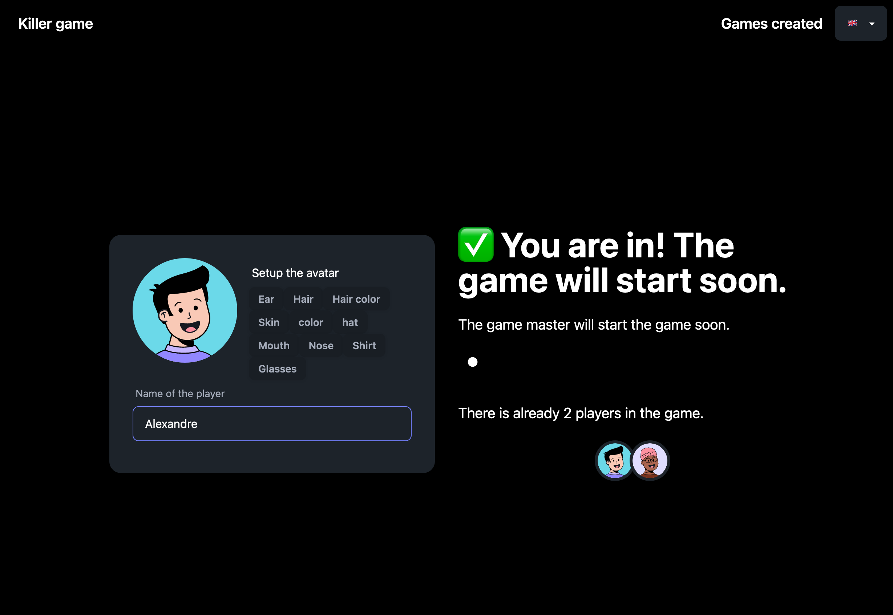

# 🎉 Killer Game Generator 🎉

Welcome to the Killer Game Generator! This application is your go-to tool for creating thrilling Killer games for your next party. Get ready for a night of excitement and suspense!



## 🚀 Quick Start

Get your game up and running in no time!

```sh
corepack enable # installs the pnpm version pinned in package.json
pnpm install
pnpm dev
```

You might need to run database migrations:

```sh
cd api
pnpm exec knex migrate:latest
```

### 🐳 Docker

Build and run your containers with ease:

```sh
docker build . -f frontend.Dockerfile -t killer-frontend
docker build . -f api.Dockerfile -t killer-api
docker run -p 3001:3001 killer-api
```

> Check out [build.sh](./build.sh) for more build options.

To run the project:

```sh
docker run -p 3000:3000 -d arousseau/killer-game-frontend
# Using a volume for the SQLite database
docker run -p 3001:3001 -v "$PWD/db:/app/api/db" arousseau/killer-game-api
```

### 🌊 Docker Swarm

Deploy your game quickly using Docker Swarm:

```sh
docker stack deploy -c docker-compose.yml killer-game
```

> Check [the GitHub workflow](./.github/workflows/api.yml) to see how Docker Swarm is used for the deployment of [the-killer.online](https://the-killer.online).

### Reverse proxy

When running behind a reverse proxy, make sure the proxy forwards the original scheme and port to the frontend container. Without `X-Forwarded-Proto` and `X-Forwarded-Port`, the Next.js standalone server builds redirect URLs using the internal container port (`:3000`).

See the example Apache virtual host in [`doc/apache-vhost.conf`](./doc/apache-vhost.conf).

## 🤖 AI / MCP Integration

The app exposes two AI-friendly entry points:

### `llms.txt`

A curated index for LLM agents is served at `https://the-killer.online/llms.txt`. It lists the most useful product, documentation, and API pages so AI assistants can discover the app without crawling the whole site.

### MCP Server

The API implements the [Model Context Protocol](https://modelcontextprotocol.io/) at `/mcp` (e.g. `https://api.the-killer.online/mcp`). AI clients such as Claude Code, Cursor, or any MCP-compatible host can use it to manage games and players.

Available tools:

- `create_game`
- `list_games`
- `get_game`
- `update_game`
- `start_game`
- `finish_game`
- `delete_game`
- `list_players`
- `add_player`
- `update_player`
- `remove_player`
- `eliminate_player`

Admin tools require the game admin token (the `private_token` returned by `create_game`, also exposed as `game_admin_token`). Provide it either in the `Authorization` header (raw token or `Bearer <token>`) or as the `game_admin_token` tool argument; the argument wins over the header. A player's own token (`player_token`) is not accepted by admin tools.

Game records returned to an admin include an `admin_url` (`https://the-killer.online/en/games/<slug>?password=<private_token>`) that opens the organizer dashboard; player records include a `player_url`. All MCP timestamps are ISO 8601 UTC.

#### Example Claude Code / Cursor config

```json
{
  "mcpServers": {
    "killer-game": {
      "url": "https://api.the-killer.online/mcp",
      "headers": { "Authorization": "${MCP_AUTH_TOKEN}" }
    }
  }
}
```

Set `MCP_AUTH_TOKEN` to the `private_token` of the game you want to manage.

For provider-specific setup instructions — Claude Code, Claude Desktop, Cursor, Mistral / Le Chat, or any other MCP client — see the **[AI / MCP setup guide](https://the-killer.online/en/docs/ai)** (also available in French at `/fr/docs/ai`).

## 🎈 Fun Facts About Killer Games

- **Origin**: Killer games originated in the 1980s and have since become a popular party game worldwide.
- **Objective**: The goal is to eliminate other players by completing tasks or challenges assigned to you.
- **Strategy**: Think strategically about who to target and when to act to stay in the game the longest.
- **Survival**: The last player standing wins the game and becomes the ultimate survivor!

Get ready to have a blast with the Killer Game Generator! 🎉🎊
